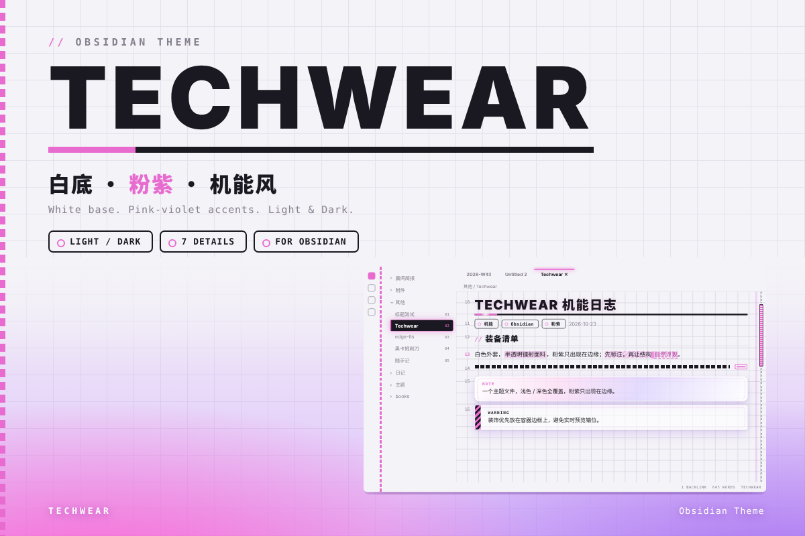
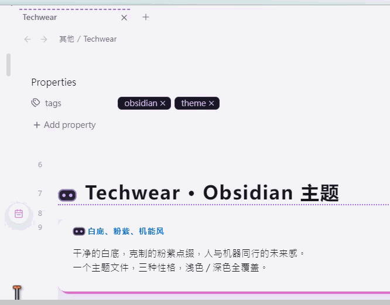

# Techwear

## 截图 / Screenshots

## 配色方案 / Schemes

通过 **Settings → WTCC 2026 → 方案** 切换，三种方案合一：

| 方案 | body 类 | 风格 |
|------|---------|------|
| B1 机能装备 | `wtcc-gear` | 织带 / 吊牌 / 半透明镭射外套（默认）|
| B2 倒影地面 | `wtcc-floor` | 内容溶进粉紫地面 / 阵容胶囊 |
| B3 机器人伙伴 | `wtcc-bot` | 面罩 LED 标签 / 机器人脸图标 |

> Switch via **Settings → WTCC 2026 → Scheme**. Three schemes in one:

> | Scheme | body class | Style |
> |--------|-----------|-------|
> | B1 Gear | `wtcc-gear` | straps / tags / translucent holographic shell (default) |
> | B2 Floor | `wtcc-floor` | content melts into pink-purple floor / capsule |
> | B3 Bot | `wtcc-bot` | visor LED labels / robot face icon |

## 特色 / Features

- **三方案合一**：B1 机能 / B2 倒影 / B3 机器人，Settings 一键切换
- **浅色 / 深色**双模式，粉紫渐变统一调色板
- **JetBrains Mono** 等宽字体，代码块深底高对比
- 机能织带、镭射玻璃面板、机器人 LED 标签等主题化装饰

> - **Three schemes in one**: B1 Gear / B2 Floor / B3 Bot, one-click switch in Settings
> - **Light / Dark** dual modes, unified pink-purple palette
> - **JetBrains Mono** monospace, high-contrast dark code blocks
> - Techwear straps, holographic glass panels, robot LED labels

## 插件推荐 / Recommended Plugin

> 
>
> [SwiftSwitch](https://community.obsidian.md/plugins/swift-snippets) — quickly switch themes and color schemes right from the tab bar

## 安装 / Installation

1. 下载 `manifest.json` 与 `theme.css` 放入 `.obsidian/themes/Techwear/`
2. 设置 → 外观 → 主题选择 **Techwear**

> 1. Drop `manifest.json` and `theme.css` into `.obsidian/themes/Techwear/`
> 2. Settings → Appearance → Theme → **Techwear**
