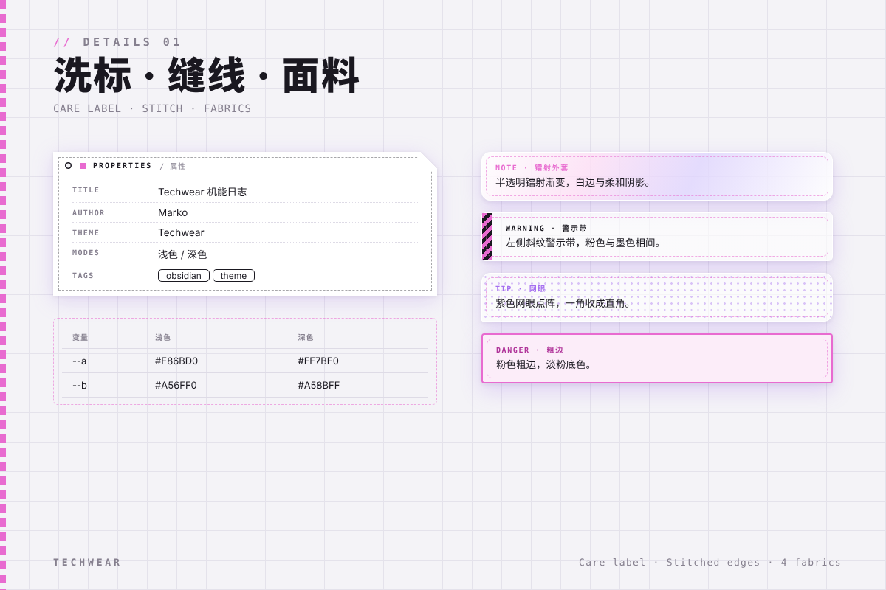
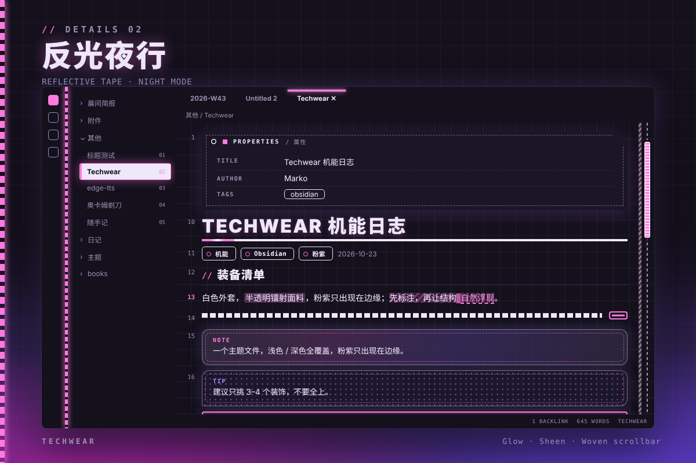
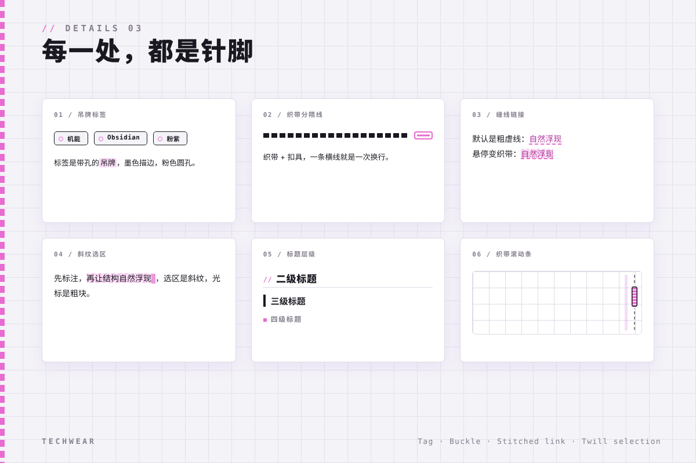

# Techwear

WTCC 2026 海报灵感的机能风 Obsidian 主题：织带 · 吊牌 · 半透明镭射外套 · 方格底纹，粉紫点缀，浅色 / 深色双模式。

> A techwear-style Obsidian theme inspired by the WTCC 2026 poster: woven straps, hang tags, translucent holographic shells and a subtle grid texture, with pink-purple accents in light / dark modes.

## 截图 / Screenshots

## 特色 / Features

- **方格底纹**：编辑器背景细方格，随内容滚动
- **洗标 Properties**：属性面板做成服装洗标样式
- **面料 Callout**：Note 镭射外套 / Warning 警示带 / Tip 网眼 / Danger 粗边，四种面料
- **吊牌标签**：标签带孔，墨色描边、粉色圆孔
- **织带分隔线 + 滚动条**：织带 + 扣具，一条横线就是一次换行
- **反光条 · 缝线链接 · 斜纹选区**：反光高亮、虚线缝线链接、斜纹选区与粗块光标
- **JetBrains Mono** 等宽字体，代码块深底高对比

> - **Grid texture**: subtle grid background that scrolls with content
> - **Care-label Properties**: properties panel styled as a garment care label
> - **Fabric callouts**: holographic shell / hazard tape / mesh / bold edge
> - **Hang-tag tags**: tags with a punched hole, ink outline and pink eyelet
> - **Woven strap dividers & scrollbar**: strap + buckle, one rule per line break
> - **Reflective tape, stitched links, twill selection**: glow highlights, dashed stitched links, twill selection and block cursor
> - **JetBrains Mono** monospace, high-contrast dark code blocks

## 插件推荐 / Recommended Plugin

> 
>
> [SwiftSwitch](https://community.obsidian.md/plugins/swift-snippets) — quickly switch themes and color schemes right from the tab bar

## 安装 / Installation

1. 下载 `manifest.json` 与 `theme.css` 放入 `.obsidian/themes/Techwear/`
2. 设置 → 外观 → 主题选择 **Techwear**

> 1. Drop `manifest.json` and `theme.css` into `.obsidian/themes/Techwear/`
> 2. Settings → Appearance → Theme → **Techwear**
